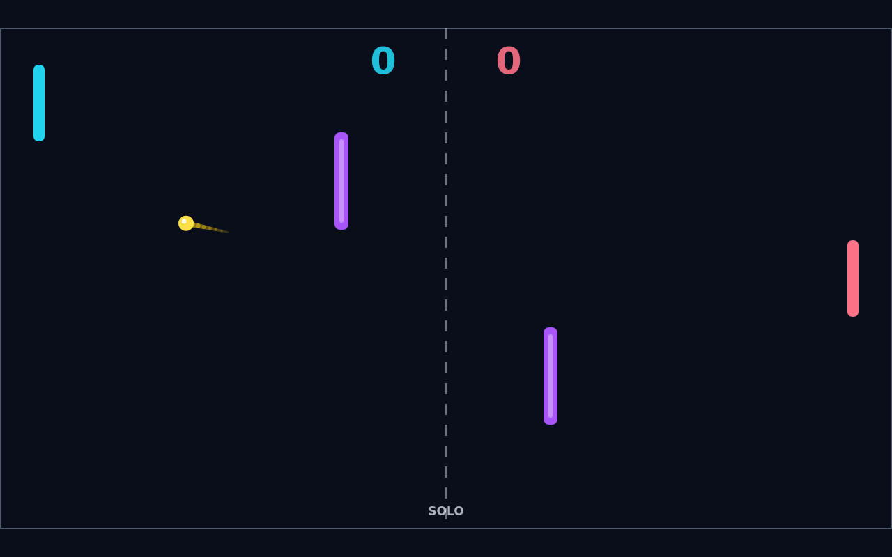
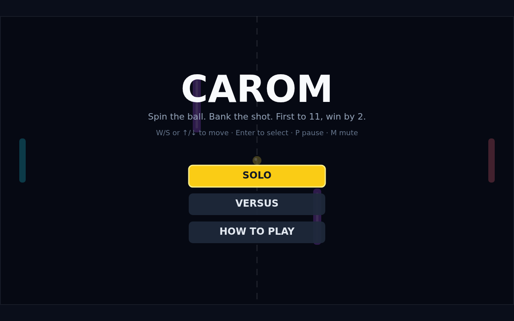

Carom is a top-down paddle duel built for quick, readable rallies on a dark, neon field. Two paddles face off across a dashed centre line while a bright ball tears back and forth, but the field is never completely open: two purple obstacles sit in the middle ground, turning every exchange into a choice between driving straight through the gap or banking the ball around a post.

A match starts with a short hold at centre, then the serve fires toward the player who was just scored on — or, at the very first point, toward the left. From there the pace only grows: every paddle hit makes the ball a little faster, wall bounces keep the rally honest, and points tick up toward eleven. Eleven alone is not enough, though. You have to lead by two, so a 10–10 match keeps tightening until somebody finally strings two points together.

What makes Carom feel different is spin. If your paddle is moving when it meets the ball, that motion is poured into the shot: strike while sliding down and the ball bows one way, strike while sliding up and it curls the other, holding its curve as the spin slowly bleeds away. A stationary paddle sends the ball back clean, while a moving one can bend a return around an obstacle, away from a waiting opponent, or back in behind them off a bank.

Those obstacles reward invention. They block lazy centre shots, deflect angled ones into unexpected lanes, and give a spinning ball something to slingshot around on its way through. Solo play pits you against an AI that tracks incoming balls and drifts back to centre when the pressure is off; Versus turns the same keyboard into a shared duel, one player on W and S, the other on the arrow keys. Either way, the best rallies are the curved ones — spin applied at the paddle, read off the trail, and cashed in off an obstacle.

